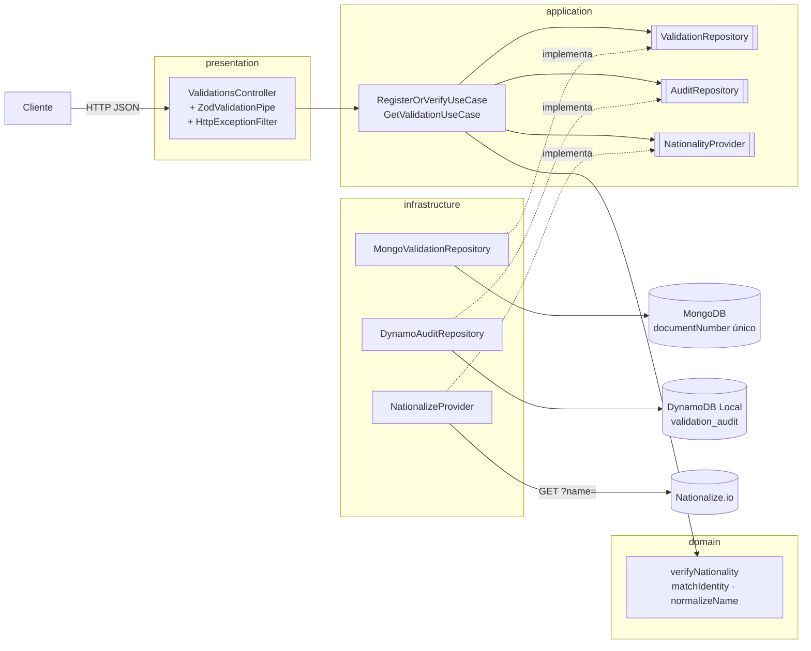
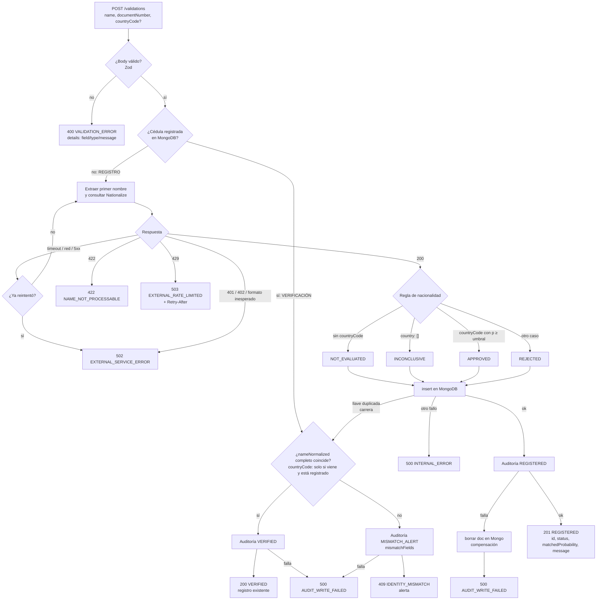
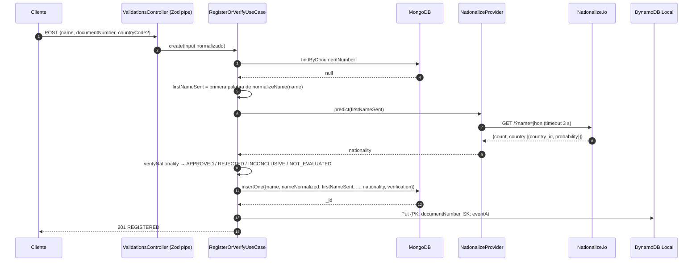
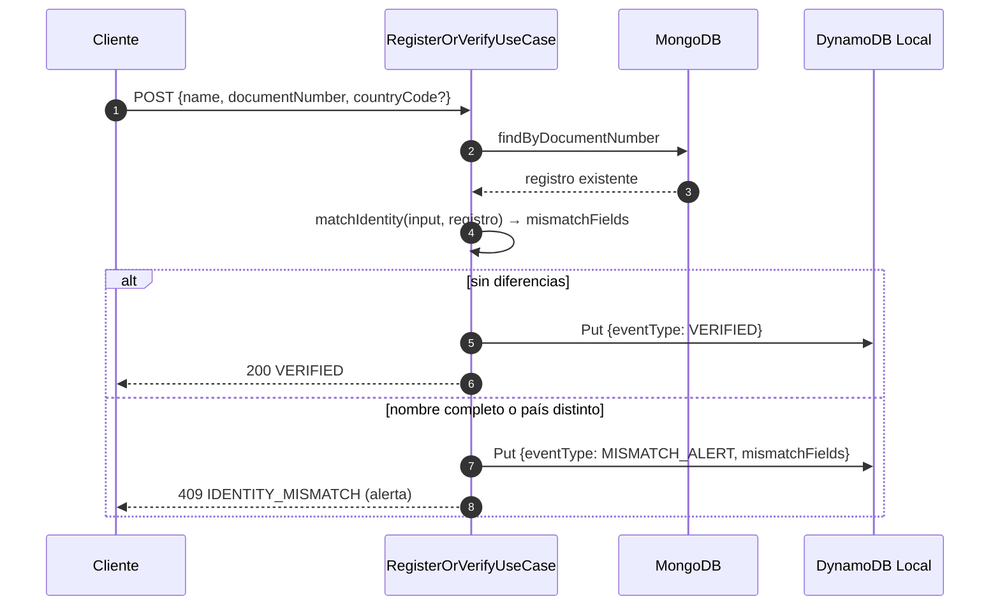
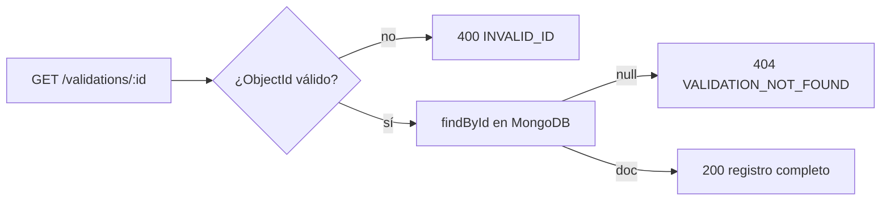

# Flujo de datos

## Componentes

Las dependencias apuntan hacia dentro: el caso de uso solo conoce los puertos, y `ValidationsModule` inyecta los adaptadores.

Solo el primer nombre normalizado (`firstNameSent`) sale hacia Nationalize, y solo al registrar. El nombre completo, `documentNumber` y `countryCode` no salen del servicio.

## POST /validations: registrar o verificar

- Las salidas 400, 422, 502 y 503 no escriben nada.
- Toda respuesta 201, 200 o 409 deja su evento en DynamoDB.
- Solo 201 escribe en MongoDB.

## POST: registro, camino feliz

## POST: verificación (cédula ya registrada)

## GET /validations/:id

GET no consulta Nationalize ni DynamoDB.
